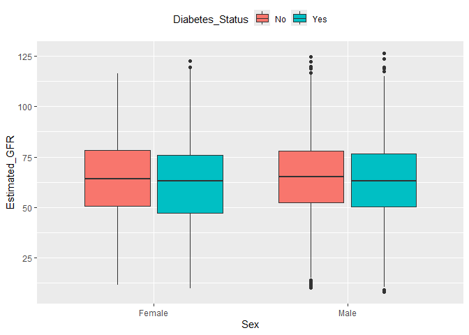
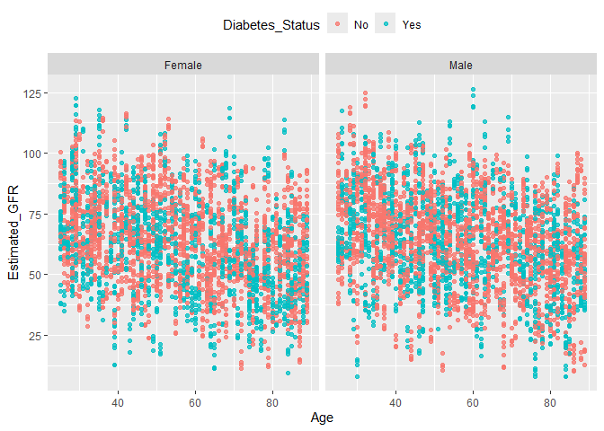
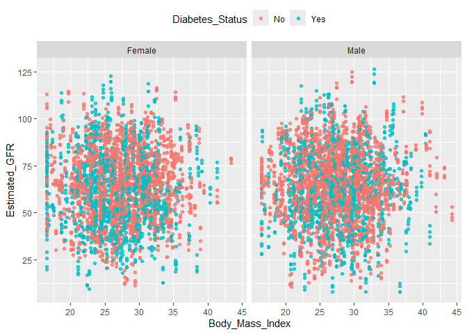
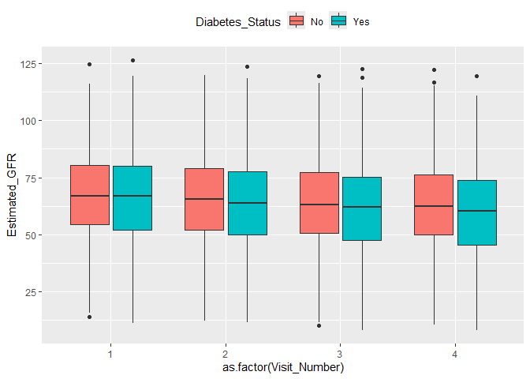
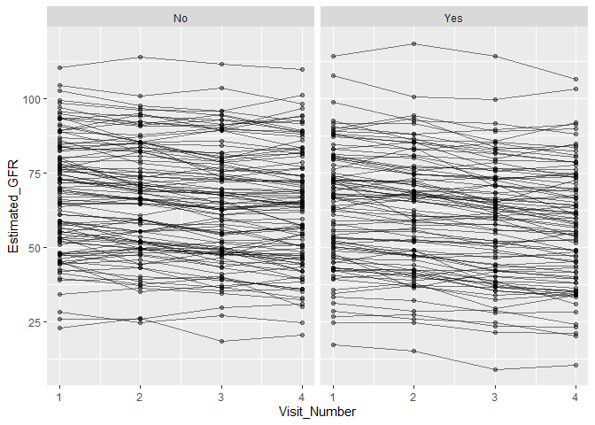

# Group Project R Code


# Chronic Disease EHR Dataset

[Link to
Dataset](https://www.kaggle.com/datasets/zara2099/chronic-disease-ehr-dataset?resource=download)

``` r
library(readr)
library(tidyverse)
library(knitr)
library(ggplot2)
library(gtsummary)
library(gt)

chronic_data <- read_csv("Chronic_Disease_EHR_Dataset.csv") 
```

``` r
chronic_data %>%
  group_by(Patient_ID) %>%
  summarize(n_obs = n(), .groups = "drop") %>%
  summarize(
    n_clusters = n(),                     # number of unique participants
    avg_obs_per_cluster = mean(n_obs)
  ) %>%
  kable() # outputs into nice table :D
```

| n_clusters | avg_obs_per_cluster |
|-----------:|--------------------:|
|       1750 |                   4 |

There are 1750 participants in this data set. With 4 observations on
average per participant.

# Exploratory Data Analysis

Our Primary outcome of interest is `Estimated_GFR`. or estimated
glomerular filtration rate (eGFR), a continuous measure of kidney
function.

``` r
ggplot(chronic_data, aes(x = Sex, y = Estimated_GFR, fill = Diabetes_Status)) +
  geom_boxplot() +
  theme(legend.position = "top") 
```

<div id="fig-boxplot-GFR-Sex-Diabetes">



Figure 1: Box-Plot of Estimated GFR by Sex and Diabetes Status

</div>

``` r
ggplot(chronic_data, aes(x = Age, y = Estimated_GFR, color = Diabetes_Status)) +
  geom_point(alpha = 0.75) +
  facet_wrap( ~ Sex) +
  theme(legend.position = "top") 
```

<div id="fig-scatterplot-GFR-Age-Sex-Diabetes">



Figure 2: Scatter Plot of Estimated GFR by Age, grouped by Sex and
Diabetes Status

</div>

``` r
ggplot(chronic_data, aes(x = Body_Mass_Index, y = Estimated_GFR, color = Diabetes_Status)) +
  geom_point(alpha = 0.75) +
  facet_wrap( ~ Sex) +
  theme(legend.position = "top") 
```

<div id="fig-scatterplot-GFR-BMI-Sex-Diabetes">



Figure 3: Scatter Plot of Estimated GFR by BMI, grouped by Sex and
Diabetes Status

</div>

``` r
ggplot(chronic_data, (aes(x = as.factor(Visit_Number), y = Estimated_GFR, fill = Diabetes_Status))) +
  geom_boxplot() +
  theme(legend.position = "top") 
```

<div id="fig-boxplot-GFR-Visit-Diabetes">



Figure 4: BoxPlot of Estimated GFR over time (Visit Number), by Diabetes
Status

</div>

``` r
# Taking a sample of the data so that it doesn't look so cluttered in the plot
set.seed(123)

n_subjects <- 200

sampled_ids <- chronic_data %>%
  distinct(Patient_ID) %>%
  slice_sample(n = n_subjects)

sample_data <- chronic_data %>%
  semi_join(sampled_ids, by = "Patient_ID")


# Spaghetti Plot
ggplot(sample_data, aes(x= Visit_Number, y = Estimated_GFR, group = Patient_ID )) +
  geom_line(alpha = 0.5) +
  geom_point(alpha = 0.4) +
  facet_wrap(~ Diabetes_Status) 
```

<div id="fig-spaghettiplot-GFR-Vist">



Figure 5: Spaghetti Plot of Estimated GFR by Visit Number, grouped by
Diabetes Status

</div>

# Fitting the Model

We will be fitting a GLM with an identity link.

# Table 1

``` r
sample_data_wide <- reshape(data = sample_data,
                            idvar = "Patient_ID",
                            v.names = "Estimated_GFR",
                            timevar = "Months_From_Baseline",
                            direction = "wide")

sample_data_wide$Hypertension_Status <- sample_data_wide$Hypertension_Status %>%
  as.factor() %>%
  relevel(ref = "No")

sample_data_wide$Diabetes_Status <- sample_data_wide$Diabetes_Status %>%
  as.factor() %>%
  relevel(ref = "No")

sample_data_wide$Medication_Adherence <- sample_data_wide$Medication_Adherence %>%
  as.factor() %>%
  factor(levels = c("Low", "Moderate", "High"))

table1 <- tbl_summary(
  sample_data_wide,
  by = Diabetes_Status,
  include = c(Hypertension_Status,
              Age, Sex, Body_Mass_Index, Medication_Adherence),
  label = list(
    Hypertension_Status ~ "Participant has hypertension",
    Medication_Adherence ~ "Medication adherence",
    Body_Mass_Index ~ "Body mass index (kg/m^2)",
    Age ~ "Age (years), baseline"
    )
  ) %>%
  modify_header(
                stat_1 = "Participant does not have diabetes (N = {n})",
                stat_2 = "Participant has diabetes (N = {n})"
  ) %>%
  modify_caption(caption = "Summary of covariates at baseline.")
table1
```

<div id="xvwzkaysju" style="padding-left:0px;padding-right:0px;padding-top:10px;padding-bottom:10px;overflow-x:auto;overflow-y:auto;width:auto;height:auto;">
<style>#xvwzkaysju table {
  font-family: system-ui, 'Segoe UI', Roboto, Helvetica, Arial, sans-serif, 'Apple Color Emoji', 'Segoe UI Emoji', 'Segoe UI Symbol', 'Noto Color Emoji';
  -webkit-font-smoothing: antialiased;
  -moz-osx-font-smoothing: grayscale;
}
&#10;#xvwzkaysju thead, #xvwzkaysju tbody, #xvwzkaysju tfoot, #xvwzkaysju tr, #xvwzkaysju td, #xvwzkaysju th {
  border-style: none;
}
&#10;#xvwzkaysju p {
  margin: 0;
  padding: 0;
}
&#10;#xvwzkaysju .gt_table {
  display: table;
  border-collapse: collapse;
  line-height: normal;
  margin-left: auto;
  margin-right: auto;
  color: #333333;
  font-size: 16px;
  font-weight: normal;
  font-style: normal;
  background-color: #FFFFFF;
  width: auto;
  border-top-style: solid;
  border-top-width: 2px;
  border-top-color: #A8A8A8;
  border-right-style: none;
  border-right-width: 2px;
  border-right-color: #D3D3D3;
  border-bottom-style: solid;
  border-bottom-width: 2px;
  border-bottom-color: #A8A8A8;
  border-left-style: none;
  border-left-width: 2px;
  border-left-color: #D3D3D3;
}
&#10;#xvwzkaysju .gt_caption {
  padding-top: 4px;
  padding-bottom: 4px;
}
&#10;#xvwzkaysju .gt_title {
  color: #333333;
  font-size: 125%;
  font-weight: initial;
  padding-top: 4px;
  padding-bottom: 4px;
  padding-left: 5px;
  padding-right: 5px;
  border-bottom-color: #FFFFFF;
  border-bottom-width: 0;
}
&#10;#xvwzkaysju .gt_subtitle {
  color: #333333;
  font-size: 85%;
  font-weight: initial;
  padding-top: 3px;
  padding-bottom: 5px;
  padding-left: 5px;
  padding-right: 5px;
  border-top-color: #FFFFFF;
  border-top-width: 0;
}
&#10;#xvwzkaysju .gt_heading {
  background-color: #FFFFFF;
  text-align: center;
  border-bottom-color: #FFFFFF;
  border-left-style: none;
  border-left-width: 1px;
  border-left-color: #D3D3D3;
  border-right-style: none;
  border-right-width: 1px;
  border-right-color: #D3D3D3;
}
&#10;#xvwzkaysju .gt_bottom_border {
  border-bottom-style: solid;
  border-bottom-width: 2px;
  border-bottom-color: #D3D3D3;
}
&#10;#xvwzkaysju .gt_col_headings {
  border-top-style: solid;
  border-top-width: 2px;
  border-top-color: #D3D3D3;
  border-bottom-style: solid;
  border-bottom-width: 2px;
  border-bottom-color: #D3D3D3;
  border-left-style: none;
  border-left-width: 1px;
  border-left-color: #D3D3D3;
  border-right-style: none;
  border-right-width: 1px;
  border-right-color: #D3D3D3;
}
&#10;#xvwzkaysju .gt_col_heading {
  color: #333333;
  background-color: #FFFFFF;
  font-size: 100%;
  font-weight: normal;
  text-transform: inherit;
  border-left-style: none;
  border-left-width: 1px;
  border-left-color: #D3D3D3;
  border-right-style: none;
  border-right-width: 1px;
  border-right-color: #D3D3D3;
  vertical-align: bottom;
  padding-top: 5px;
  padding-bottom: 6px;
  padding-left: 5px;
  padding-right: 5px;
  overflow-x: hidden;
}
&#10;#xvwzkaysju .gt_column_spanner_outer {
  color: #333333;
  background-color: #FFFFFF;
  font-size: 100%;
  font-weight: normal;
  text-transform: inherit;
  padding-top: 0;
  padding-bottom: 0;
  padding-left: 4px;
  padding-right: 4px;
}
&#10;#xvwzkaysju .gt_column_spanner_outer:first-child {
  padding-left: 0;
}
&#10;#xvwzkaysju .gt_column_spanner_outer:last-child {
  padding-right: 0;
}
&#10;#xvwzkaysju .gt_column_spanner {
  border-bottom-style: solid;
  border-bottom-width: 2px;
  border-bottom-color: #D3D3D3;
  vertical-align: bottom;
  padding-top: 5px;
  padding-bottom: 5px;
  overflow-x: hidden;
  display: inline-block;
  width: 100%;
}
&#10;#xvwzkaysju .gt_spanner_row {
  border-bottom-style: hidden;
}
&#10;#xvwzkaysju .gt_group_heading {
  padding-top: 8px;
  padding-bottom: 8px;
  padding-left: 5px;
  padding-right: 5px;
  color: #333333;
  background-color: #FFFFFF;
  font-size: 100%;
  font-weight: initial;
  text-transform: inherit;
  border-top-style: solid;
  border-top-width: 2px;
  border-top-color: #D3D3D3;
  border-bottom-style: solid;
  border-bottom-width: 2px;
  border-bottom-color: #D3D3D3;
  border-left-style: none;
  border-left-width: 1px;
  border-left-color: #D3D3D3;
  border-right-style: none;
  border-right-width: 1px;
  border-right-color: #D3D3D3;
  vertical-align: middle;
  text-align: left;
}
&#10;#xvwzkaysju .gt_empty_group_heading {
  padding: 0.5px;
  color: #333333;
  background-color: #FFFFFF;
  font-size: 100%;
  font-weight: initial;
  border-top-style: solid;
  border-top-width: 2px;
  border-top-color: #D3D3D3;
  border-bottom-style: solid;
  border-bottom-width: 2px;
  border-bottom-color: #D3D3D3;
  vertical-align: middle;
}
&#10;#xvwzkaysju .gt_from_md > :first-child {
  margin-top: 0;
}
&#10;#xvwzkaysju .gt_from_md > :last-child {
  margin-bottom: 0;
}
&#10;#xvwzkaysju .gt_row {
  padding-top: 8px;
  padding-bottom: 8px;
  padding-left: 5px;
  padding-right: 5px;
  margin: 10px;
  border-top-style: solid;
  border-top-width: 1px;
  border-top-color: #D3D3D3;
  border-left-style: none;
  border-left-width: 1px;
  border-left-color: #D3D3D3;
  border-right-style: none;
  border-right-width: 1px;
  border-right-color: #D3D3D3;
  vertical-align: middle;
  overflow-x: hidden;
}
&#10;#xvwzkaysju .gt_stub {
  color: #333333;
  background-color: #FFFFFF;
  font-size: 100%;
  font-weight: initial;
  text-transform: inherit;
  border-right-style: solid;
  border-right-width: 2px;
  border-right-color: #D3D3D3;
  padding-left: 5px;
  padding-right: 5px;
}
&#10;#xvwzkaysju .gt_stub_row_group {
  color: #333333;
  background-color: #FFFFFF;
  font-size: 100%;
  font-weight: initial;
  text-transform: inherit;
  border-right-style: solid;
  border-right-width: 2px;
  border-right-color: #D3D3D3;
  padding-left: 5px;
  padding-right: 5px;
  vertical-align: top;
}
&#10;#xvwzkaysju .gt_row_group_first td {
  border-top-width: 2px;
}
&#10;#xvwzkaysju .gt_row_group_first th {
  border-top-width: 2px;
}
&#10;#xvwzkaysju .gt_summary_row {
  color: #333333;
  background-color: #FFFFFF;
  text-transform: inherit;
  padding-top: 8px;
  padding-bottom: 8px;
  padding-left: 5px;
  padding-right: 5px;
}
&#10;#xvwzkaysju .gt_first_summary_row {
  border-top-style: solid;
  border-top-color: #D3D3D3;
}
&#10;#xvwzkaysju .gt_first_summary_row.thick {
  border-top-width: 2px;
}
&#10;#xvwzkaysju .gt_last_summary_row {
  padding-top: 8px;
  padding-bottom: 8px;
  padding-left: 5px;
  padding-right: 5px;
  border-bottom-style: solid;
  border-bottom-width: 2px;
  border-bottom-color: #D3D3D3;
}
&#10;#xvwzkaysju .gt_grand_summary_row {
  color: #333333;
  background-color: #FFFFFF;
  text-transform: inherit;
  padding-top: 8px;
  padding-bottom: 8px;
  padding-left: 5px;
  padding-right: 5px;
}
&#10;#xvwzkaysju .gt_first_grand_summary_row {
  padding-top: 8px;
  padding-bottom: 8px;
  padding-left: 5px;
  padding-right: 5px;
  border-top-style: double;
  border-top-width: 6px;
  border-top-color: #D3D3D3;
}
&#10;#xvwzkaysju .gt_last_grand_summary_row_top {
  padding-top: 8px;
  padding-bottom: 8px;
  padding-left: 5px;
  padding-right: 5px;
  border-bottom-style: double;
  border-bottom-width: 6px;
  border-bottom-color: #D3D3D3;
}
&#10;#xvwzkaysju .gt_striped {
  background-color: rgba(128, 128, 128, 0.05);
}
&#10;#xvwzkaysju .gt_table_body {
  border-top-style: solid;
  border-top-width: 2px;
  border-top-color: #D3D3D3;
  border-bottom-style: solid;
  border-bottom-width: 2px;
  border-bottom-color: #D3D3D3;
}
&#10;#xvwzkaysju .gt_footnotes {
  color: #333333;
  background-color: #FFFFFF;
  border-bottom-style: none;
  border-bottom-width: 2px;
  border-bottom-color: #D3D3D3;
  border-left-style: none;
  border-left-width: 2px;
  border-left-color: #D3D3D3;
  border-right-style: none;
  border-right-width: 2px;
  border-right-color: #D3D3D3;
}
&#10;#xvwzkaysju .gt_footnote {
  margin: 0px;
  font-size: 90%;
  padding-top: 4px;
  padding-bottom: 4px;
  padding-left: 5px;
  padding-right: 5px;
}
&#10;#xvwzkaysju .gt_sourcenotes {
  color: #333333;
  background-color: #FFFFFF;
  border-bottom-style: none;
  border-bottom-width: 2px;
  border-bottom-color: #D3D3D3;
  border-left-style: none;
  border-left-width: 2px;
  border-left-color: #D3D3D3;
  border-right-style: none;
  border-right-width: 2px;
  border-right-color: #D3D3D3;
}
&#10;#xvwzkaysju .gt_sourcenote {
  font-size: 90%;
  padding-top: 4px;
  padding-bottom: 4px;
  padding-left: 5px;
  padding-right: 5px;
}
&#10;#xvwzkaysju .gt_left {
  text-align: left;
}
&#10;#xvwzkaysju .gt_center {
  text-align: center;
}
&#10;#xvwzkaysju .gt_right {
  text-align: right;
  font-variant-numeric: tabular-nums;
}
&#10;#xvwzkaysju .gt_font_normal {
  font-weight: normal;
}
&#10;#xvwzkaysju .gt_font_bold {
  font-weight: bold;
}
&#10;#xvwzkaysju .gt_font_italic {
  font-style: italic;
}
&#10;#xvwzkaysju .gt_super {
  font-size: 65%;
}
&#10;#xvwzkaysju .gt_footnote_marks {
  font-size: 75%;
  vertical-align: 0.4em;
  position: initial;
}
&#10;#xvwzkaysju .gt_asterisk {
  font-size: 100%;
  vertical-align: 0;
}
&#10;#xvwzkaysju .gt_indent_1 {
  text-indent: 5px;
}
&#10;#xvwzkaysju .gt_indent_2 {
  text-indent: 10px;
}
&#10;#xvwzkaysju .gt_indent_3 {
  text-indent: 15px;
}
&#10;#xvwzkaysju .gt_indent_4 {
  text-indent: 20px;
}
&#10;#xvwzkaysju .gt_indent_5 {
  text-indent: 25px;
}
&#10;#xvwzkaysju .katex-display {
  display: inline-flex !important;
  margin-bottom: 0.75em !important;
}
&#10;#xvwzkaysju div.Reactable > div.rt-table > div.rt-thead > div.rt-tr.rt-tr-group-header > div.rt-th-group:after {
  height: 0px !important;
}
</style>

<table class="gt_table" data-quarto-postprocess="true"
data-quarto-disable-processing="false" data-quarto-bootstrap="false">
<caption>Summary of covariates at baseline.</caption>
<colgroup>
<col style="width: 33%" />
<col style="width: 33%" />
<col style="width: 33%" />
</colgroup>
<thead>
<tr class="gt_col_headings">
<th id="label" class="gt_col_heading gt_columns_bottom_border gt_left"
data-quarto-table-cell-role="th"
scope="col"><strong>Characteristic</strong></th>
<th id="stat_1"
class="gt_col_heading gt_columns_bottom_border gt_center"
data-quarto-table-cell-role="th" scope="col">Participant does not have
diabetes (N = 106)<span class="gt_footnote_marks"
style="white-space:nowrap;font-style:italic;font-weight:normal;line-height:0;"><sup>1</sup></span></th>
<th id="stat_2"
class="gt_col_heading gt_columns_bottom_border gt_center"
data-quarto-table-cell-role="th" scope="col">Participant has diabetes (N
= 94)<span class="gt_footnote_marks"
style="white-space:nowrap;font-style:italic;font-weight:normal;line-height:0;"><sup>1</sup></span></th>
</tr>
</thead>
<tbody class="gt_table_body">
<tr>
<td class="gt_row gt_left" headers="label">Participant has
hypertension</td>
<td class="gt_row gt_center" headers="stat_1">70 (66%)</td>
<td class="gt_row gt_center" headers="stat_2">52 (55%)</td>
</tr>
<tr>
<td class="gt_row gt_left" headers="label">Age (years), baseline</td>
<td class="gt_row gt_center" headers="stat_1">58 (44, 71)</td>
<td class="gt_row gt_center" headers="stat_2">53 (39, 70)</td>
</tr>
<tr>
<td class="gt_row gt_left" headers="label">Sex</td>
<td class="gt_row gt_center" headers="stat_1"><br />
</td>
<td class="gt_row gt_center" headers="stat_2"><br />
</td>
</tr>
<tr>
<td class="gt_row gt_left" headers="label">    Female</td>
<td class="gt_row gt_center" headers="stat_1">52 (49%)</td>
<td class="gt_row gt_center" headers="stat_2">45 (48%)</td>
</tr>
<tr>
<td class="gt_row gt_left" headers="label">    Male</td>
<td class="gt_row gt_center" headers="stat_1">54 (51%)</td>
<td class="gt_row gt_center" headers="stat_2">49 (52%)</td>
</tr>
<tr>
<td class="gt_row gt_left" headers="label">Body mass index (kg/m^2)</td>
<td class="gt_row gt_center" headers="stat_1">28.8 (24.8, 32.3)</td>
<td class="gt_row gt_center" headers="stat_2">28.0 (24.4, 31.0)</td>
</tr>
<tr>
<td class="gt_row gt_left" headers="label">Medication adherence</td>
<td class="gt_row gt_center" headers="stat_1"><br />
</td>
<td class="gt_row gt_center" headers="stat_2"><br />
</td>
</tr>
<tr>
<td class="gt_row gt_left" headers="label">    Low</td>
<td class="gt_row gt_center" headers="stat_1">29 (27%)</td>
<td class="gt_row gt_center" headers="stat_2">23 (24%)</td>
</tr>
<tr>
<td class="gt_row gt_left" headers="label">    Moderate</td>
<td class="gt_row gt_center" headers="stat_1">36 (34%)</td>
<td class="gt_row gt_center" headers="stat_2">44 (47%)</td>
</tr>
<tr>
<td class="gt_row gt_left" headers="label">    High</td>
<td class="gt_row gt_center" headers="stat_1">41 (39%)</td>
<td class="gt_row gt_center" headers="stat_2">27 (29%)</td>
</tr>
</tbody><tfoot>
<tr class="gt_footnotes">
<td colspan="3" class="gt_footnote"><span class="gt_footnote_marks"
style="white-space:nowrap;font-style:italic;font-weight:normal;line-height:0;"><sup>1</sup></span>
n (%); Median (Q1, Q3)</td>
</tr>
</tfoot>
&#10;</table>

</div>
